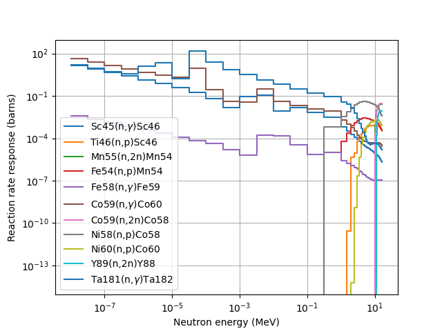

======
Theory
======

This guide covers the fundamentals of unfolding, along with descriptions of the various algorithms included with SPECTRA-UF.

Unfolding fundamentals
----------------------

The process of unfolding starts with the kernal equation which originates from a Freidholm integral equation
of the first kind, show in equation :eq:`eq_friedholm_integral`, where :math:`Z_{0i}` is a vector containing 
the m meassured values, :math:`R_i(E)` is the response for the ith measured value and :math:`\Phi` is the 
distribution of the solution we aim to solve for.

.. math:: Z_{0i} = \int_0^\infty R_i(E)\Phi(E)dE, \quad i = 1, 2,..., m
   :label: eq_friedholm_integral

This series of integral equations are represented in a discretised form, seen in equation :eq:`eq_kernel`,
where :math:`Z_{0i}` is the ith measured value, :math:`\Phi_j` is the solution in the jth bin, and :math:`R_{i,j}` 
is the response of the ith measured value to the jth solution bin.

.. math:: Z_{0i} = \sum_{j=1}^n R_{i,j}  \Phi_j \quad j = 1, 2,..., n
   :label: eq_kernel

The unfolding kernel can in theory be solved via matrix inversion, :math:`\Phi_j = Z_{0i} \cdot R_{i,j}^{-1}`, however 
during application to experimental systems it is typically not possible to take the inverse of the response matrix due
to the response matrix being non-full rank, making the system of equations ill-conditioned. This is caused by
zero values within the response matrix or non-linear independence within the matrix be columns or rows approaching or
being ratios of one another. The ill-conditioned nature is exasabated by the uncertainties of the measured values
and response matrix.

The methods included in SPECTRA-UF aim to find approximate solutions to this ill-conditioned series of equations, with a
range of mathematical approaches available. These typically require a way of constraining the solution either via the
intoduction of an initial set of values for the vector :math:`\Phi_j`, or by constraining the solution using known
physical properties such as physical distributions or smoothing.

Neutron spectrum unfolding
--------------------------

Neutron spectrum unfolding can be applied to spectromerty data from detection systems such as activation
foils, Bonner spheres or passive neutron spectrometers.

Lets consider the applciation to activation foil neutron spectrometry, whereby the :math:`Z_i` is the reaction 
rate during irradiation for a given reaction channel producing some measurable daughter product. The response
matrix :math:`R_{i,j}` represents the reaction rate per unit flux, with the solution vector :math:`\Phi_{j}` is the flux.



The shape of the response matrix in this inverse problem will take the shape of m rows and n columns, with the ith row
being the response to one of the ith reaction channels, and the rows contining a response for each of the jth flux bins.

The conditioned required to allow matrix inversion is that the matrix should be square (m >= n) and also full rank so
that the rows and columns are linearly independent of one another. If these rows or columns are ratios of one another or
close to being ratios then information stored in the system will be lost. Due to the similarity in shape of the response
within activation foils this loss of information can have a large effect on the reliability of the solution. To maximise
information stored, more foils are typically required along with a realistic group structure in the flux spectrum so
that m is close to n.

Non-linear least square
```````````````````````

The non-linear least square methods try to minimise the chi-squared between the *measured* values and the *calculated* values
generated for a *solution*. A commonly used unfolding method is the GRAVEL algorithm found in the HEPRO and UMG3 codes, and
was authored by Marfred Matzke. The GRAVEL algorithm is based on the United States Air Force (USAF) activation foil 
inference code SAND-II, writtern in 1967, with the GRAVEL algorithm modifying it to take into account the uncertainty
associated with the measured values. 

The iterative method of the **NonlinearLeastSquareIterativeB** metho dis based on the mathematics of the GRAVEL method, the
iterative equation is shown in :eq:`eq_gravel_main`, where the solution :math:`\Phi_j` is kept in log space to ensure that
the solution always maintais a positive value. The lambda vector and the weighting matrix are shwon in equations
:eq:`eq_gravel_lambdas` and :eq:`eq_gravel_weight` respectively. The uncertainty vector :math:`\rho_i` shown in equation :eq:`eq_gravel_uncertainy` 
applies the uncertainty weighting using the *measured* values in :math:`Z_0i` and their associated absolute uncertainties :math:`\sigma_0i`.

.. math:: \ln\Phi^{(k+1)} = \ln \Phi_j^{(k)} + \lambda_j^{(k)}\sum_{i=1}^{m}\Big[(\ln Z_{0i} - \ln Z_i^{(k)}) \frac{\omega_{i,j}^{(k)}}{\rho_i^2}\Big]
   :label: eq_gravel_main

.. math:: \lambda_j^{(k)} = \Big( \sum_{i=1}^m \frac{\omega_{i,j}^{(k)}}{\rho_i^2}\Big)^{-1}
   :label: eq_gravel_lambdas

.. math:: \omega_{i,j}^{(k)} = \frac{R_{i,j}\Phi_j^{(k)}}{Z_i^{(k)}}
   :label: eq_gravel_weight

.. math:: \rho_i = \frac{\sigma_{0i}}{z_{0i}}
   :label: eq_gravel_uncertainy

Maximum potential entropy
`````````````````````````

The maximum potential entropy method is based on information theory and aims to find a *solution* which satisfies three
criteria, first the matching of the *measured* and *calculated* values, the second is a fitting factor equivalent to the
reduced chi-squared per degree of freedom and the third is to minimize the Kullback-Leibler divergence (:math:`D_{KL}`) between the 
*a priori* and the *solution*. The :math:`D_{KL}` is a measure of the relative entropy between two distributions, and is shown in equation :eq:`eq_kullback_beibler_divergence`.

.. math:: D_{KL}(P || Q) = \sum_{x \in X}P(x) \log \left( \frac{P(x)}{Q(x)} \right)
   :label: eq_kullback_beibler_divergence

Equation :eq:`eq_maxed_relative_entropy` shows the relative entropy term :math:`S` with the *a priori* distribution written
as :math:`\Phi_j^{DEF}` and the *solution* as :math:`\Phi_j`.

.. math:: S = - \sum_{i=1}^{m}\Big[\Phi_j\ln \left(\frac{\Phi_j}{\Phi_j^{DEF}}\right)+\Phi_j^{DEF} - \Phi_j\Big]
   :label: eq_maxed_relative_entropy

Equation :eq:`eq_maxed_measured_fit` shows the criteria of the *measured* and *calculated* vlaues from the *solution*.

.. math:: Z_i + \epsilon_i = \sum_{j=1}^{n}R_{i,j}\Phi_{i} \quad i = 1, 2,...,m
   :label: eq_maxed_measured_fit

Equation :eq:`eq_maxed_uncertainty_weighting` shows the :math:`\Omega` uncertainty cretiria.

.. math:: \sum_{i=1}^{m} \frac{\epsilon_i^2}{\sigma_i^2} = \Omega
   :label: eq_maxed_uncertainty_weighting

Equation :eq:`eq_maxed_legrangian` shows the legrange multiplers system of equations.

.. math:: \mathcal{L}(\Phi_j, \epsilon_i, \lambda_i, \mu) = -\sum_{j=1}^{n}\Bigg[\Phi_j \ln \left( \frac{\Phi_j}{\Phi_j^{DEF}} \right) + \Phi_j^{DEF} - \Phi_j\Bigg] \\ - \sum_{i=1}^{M}\lambda_i \left( \sum_{j=1}^{n} R_{i, j}\Phi_j - N_i  - \epsilon_i \right)  - \mu\Bigg[ \sum_{i=1}^{m} \left( \frac{\epsilon_i}{\sigma_i} \right)^2 - \Omega \Bigg]
   :label: eq_maxed_legrangian

The series of Legrange multipler equations reduces to a potential entropy with yields a solution via 
the stochastic optimisation of the lambda values in order to maximise :math:`H`.

.. math:: H = -\sum_{j=1}^{n} f_j^{DEF}\exp\left(-\sum_{i=1}^{m} \lambda_iR_{i,j}\right) \\ -\left( \Omega\sum_{i=1}^{m} (\lambda_i \sigma_i)^2 \right)^{\frac{1}{2}}-\sum_{i=1}^{m}Z_i\lambda_i
   :label: eq_maxed_potential_entropy
